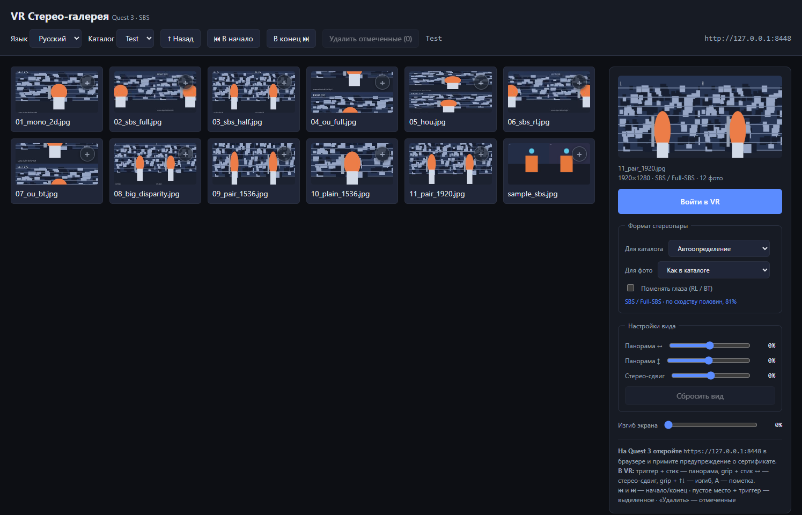

# SBS Stereo Photo Viewer for Oculus Quest 3

[Русская версия / Russian version](README.md)

A small server on your PC plus a page in the headset browser. No Steam Link, Virtual Desktop or SteamVR: Quest 3 renders stereo itself via **WebXR**.

## How it works

1. `server.py` reads `config.json` with the list of directories and serves:
   - the web client (`web/`);
   - `/api/list` — recursive directory listing (nested subfolders are supported);
   - `/api/image` — the source image (downscaled to `max_texture_size` when Pillow is available);
   - `/api/thumb` — thumbnails (cached in `thumbs/`).
2. Quest Browser opens `https://<PC-IP>:8443` and requests an `immersive-vr` session.
3. A file is loaded as **a single texture**; its layout decides which UV rectangle and which aspect ratio are used for each eye. WebXR supplies a separate view matrix for each eye with the correct IPD, so you get a proper stereo pair instead of a stretched side-by-side image. A 360 panorama is mapped onto a sphere and viewed **from the inside** — head orientation comes from WebXR. "Cylinder" mode uses a different principle instead of the same sphere: a fullscreen quad is drawn, each fragment reconstructs a ray from the projection matrix and camera rotation, longitude comes from the ray direction, and the wall height is spread over the eye's vertical field of view. The source is an equirectangular 360° image, so only its central band is stretched onto the wall: the polar rows are excluded, otherwise they still make it look like a sphere. The wall has a finite height and above/below it the view is empty by design — the picture is not repeated. Head rotation and translation do not make the picture swim.

## Quick start

### 1. Add your directories

Open `config.json`:

```json
{
  "ip": null,
  "port": 8443,
  "thumb_width": 320,
  "max_texture_size": 4096,
  "language": "en",
  "statefile": "state.json",
  "qr": true,
  "qrfile": "cert/connect.png",
  "controls": {
    "panInvertX": true,
    "panInvertY": true,
    "shiftInvert": false,
    "panStep": 0.08,
    "shiftStep": 0.005,
    "panBase": 0.35,
    "panGain": 1.0
  },
  "delete_to_trash": true,
  "roots": [
    {
      "id": "sbs",
      "name": "My SBS photos",
      "path": "D:/Stereo",
      "sbs": "auto",
      "pano_mode": "sphere",
      "pano_cyl_vfill": 1.0,
      "pano_cyl_vcrop": 0.5,
      "swap": false,
      "eye_aspect": null,
      "distance": 2.0,
      "height": 1.2
    }
  ]
}
```

- `sbs`: default layout for the directory. `auto` — detect the layout of every file (recommended); `mono` — an ordinary 2D image; `sbs` / `full` — two side-by-side halves at full resolution; `half` — half-SBS, each eye compressed horizontally; `ou` — Full-OU / TAB / Top-and-Bottom, two vertical halves at full resolution; `hou` — Half-OU / HOU, each eye compressed vertically by 2; `pano` — a 360° equirectangular panorama viewed from inside a sphere. Aliases such as `2d`, `full-ou`, `half-ou`, `hsbs`, `360`, `equirect` are accepted too.
- `pano_mode`: projection for 360 panoramas — `sphere` (default) or `cylinder` (a flat image wrapped around the viewer, assumed seamless). Can also be switched in the UI; the choice is saved in `state.json` as `panoMode[rootId]`.
- `pano_cyl_vfill`: share of the eye's vertical FOV occupied by the wall in "cylinder" mode, 0.5–1.0 (default 1.0). 1.0 fills the view to the edges; smaller values leave margins.
- `pano_cyl_vcrop`: share of the source height stretched onto the wall, 0.2–1.0 (default 0.5). Smaller values exclude more spherical poles; 1.0 uses the whole frame.
- `swap`: `true` when the eyes or halves are stored in reverse order (`RL` instead of `LR`, `BT` instead of `TB`). It can be overridden per image in the UI.
- `eye_aspect`: explicit aspect ratio of one eye; when `null`, it is derived from the image size.
- `distance` / `height`: distance to the plane and its height in meters (1.5–2.5 m is comfortable).
- You can add as many `roots` as you need, each with its own path and mode.
- `language` — default UI language (`ru`, `en`, or any other file in `web/i18n/`).
- `statefile` — where to keep saved settings (per-directory zoom, curvature, pan and stereo shift, stereo layouts for directories and individual images, chosen language and last selected source).
- `qr` — `true` (default): create a PNG with the connection URL at startup. `qrfile` — where to save it. The QR is also available at `https://<PC-IP>:8443/qr`. Generation needs the optional `segno` package (`pip install -r requirements.txt`); without it the server only prints the URL. Use `--no-qr` to disable it.
- `controls` — thumbstick pan and stereo shift settings (see below).
- `delete_to_trash` — `true` (default): deleted photos go to the trash. On **Windows** the system **Recycle Bin** is used via the built-in Shell API (no extra packages). On **Linux/macOS**, install `pip install send2trash` to enable trash; otherwise deletion is permanent. `false` — always delete immediately.

#### Stereo layouts and auto-detection

| `sbs` value | What the file contains | Aspect of one eye |
|---|---|---|
| `mono` | ordinary 2D image, both eyes see the same picture | `W/H` |
| `sbs` / `full` | two side-by-side halves, no compression | `W/H / 2` |
| `half` | two side-by-side halves, each compressed horizontally | `W/H` |
| `ou` | two stacked halves, no compression | `W/H × 2` |
| `hou` | two stacked halves, each compressed vertically by 2 | `W/H` |
| `pano` | 360° panorama, no stereo pair: the viewer is inside a sphere or in front of a closed flat wall | whole texture |

Every stereo layout uses one texture: only the eye's UV rectangle and the plane aspect change. Anamorphic formats need no separate shader — the stretching is done by geometry. Panoramas use the whole texture: sphere mode uses a dedicated sphere mesh, while cylinder mode uses a fullscreen quad and reconstructs a world-space ray per fragment.

With `sbs: "auto"` each image is classified using several signals:

1. **standard 360 metadata** — Google Photo Sphere XMP (`GPano:UsePanoramaViewer`, `GPano:ProjectionType=equirectangular`, `ns.google.com/photos/1.0/panorama`) or `360` / `pano` / `equirect` filename tokens immediately give `pano`. ComfyUI workflow nodes are **ignored**: the same result can be produced by different nodes, so they are not a format signal;
2. **filename** — tokens like `sbs`, `half`, `hou`, `ou`, `tab`, `lr`, `rl`, `tb`, `bt`, `2d` (the strongest signal; `rl`/`bt` also enable `swap`);
3. **aspect ratio** — very wide files (`≥ 2.4`) are almost always full-SBS, very tall ones (`≤ 1.05`) are Full-OU. The remaining range is split as follows: `1.05–1.35` — half-SBS with portrait eyes (1536×1280), `1.35–1.6` — portrait full-SBS (1920×1280), `1.6–2.4` — regular 16:9 half-SBS;
4. **half similarity** — the image is downscaled to 96×64 and the left/right or top/bottom halves are compared. Horizontal edges are compared instead of raw brightness, with a small horizontal shift search: this handles real disparity between the eyes and avoids false matches on repeating textures;
5. **seamless 360 without metadata** — with no XMP and no filename hint, an aspect near 2:1 plus matching left/right edges and no half similarity means a panorama. Aspect 2:1 alone is not enough: full-SBS often has the same dimensions.

The result is shown in the selected-image panel with a confidence score. Auto-detection can fail on symmetric scenes and on ordinary 16:9 photos, where `mono`, `half` and `hou` share the same aspect ratio. The **Stereo layout** block has two dropdowns:

- **For directory** — auto-detect by default. Choosing a concrete layout applies it to **every image of the source** and saves it in `state.json` as `layoutDefault[rootId]`. Switching back to auto-detect removes the setting.
- **For image** — a per-file override, plus a **Swap eyes** checkbox (disabled for 2D and 360). **From directory** removes the override.
- **360° projection** — **Sphere** or **Cylinder (wall)**. Active when the current file is detected as a panorama; the choice is saved for the directory.

Priority: **image override → directory layout → `config.json` → auto-detection**. The directory setting is a safety net for folders where every photo uses the same format but the detector gets it wrong.

The same rules apply to **thumbnails**: the 2D grid and the VR gallery show a single eye with correct cropping instead of the whole file (for a 360 panorama — the whole 2:1 frame). Thumbnails are redrawn when the directory or image layout changes, and the refined result from opening the full image is applied back to its thumbnail. Rendering is lazy — only thumbnails near the visible grid area are drawn.

### 2. Generate a certificate

```bat
python tools\make_cert.py
```

The script detects the PC IP and creates `cert/cert.pem` + `cert/key.pem` with `IP:<address>` and `DNS:localhost` in the SAN.

If the IP changes (DHCP), regenerate it:

```bat
python tools\make_cert.py --ip 192.168.1.50 --force
```

You can also pin the IP in `config.json` — `make_cert.py` will read it from there.

### 3. Run

Simply:

```bat
start.bat
```

Or manually:

```bat
python server.py
```

Available flags: `--config path`, `--http` (no TLS, for `localhost` only — WebXR still works there because `localhost` is a secure context), `--no-qr` (skip QR generation at startup), `--log` (write a journal to `logs/server_<start time>.log`).

**Debugging.** Run `debug.bat` — it enables `--log`. All server requests, errors and browser messages go into a file named after the server start time. No console needed: press the **Logs** button in the page header to see the latest entries (Refresh / Clear / Close). If the server runs without `--log`, the panel only shows the browser-side buffer and reminds you about `debug.bat`. In "Cylinder (wall)" mode the client writes the gaze direction, projection parameters, coordinates `vWall` and `vSrc` with the `vcrop` parameter and the `inside` flag once every 2 seconds, so you can verify the picture depends only on head rotation, that the source poles stay out of view, and that the view above/below the wall is empty. The `logs/` folder is gitignored.

At startup the server prints the URL and the QR file path:

```text
Откройте на Quest 3: https://192.168.1.50:8443
QR-код: cert/connect.png  (или https://192.168.1.50:8443/qr)
```

The QR encodes the same address that is used for the certificate. If the IP changes, regenerate the certificate and restart the server — the QR is recreated automatically.

> Quest 3 has no general built-in QR scanner: its system QR support is limited to Wi‑Fi setup. To open the link from a QR, install any third-party QR scanner app on Quest (App Lab/SideQuest), or just type the URL manually. After the first visit you can bookmark it in Quest Browser.

### Example directory

The bundle includes an `example/` directory, described in `config.json` as the `demo` source ("Example"). It contains samples for every supported layout: `01_mono_2d.jpg`, `02_sbs_full.jpg`, `03_sbs_half.jpg`, `04_ou_full.jpg`, `05_hou.jpg`, plus `06_sbs_rl.jpg` and `07_ou_bt.jpg` with swapped eyes/halves. For detection tests there are `08_big_disparity.jpg` (large disparity), `09_pair_1536.jpg` (vertical 1536×1280 half pair with no hint in the name), `11_pair_1920.jpg` (vertical 1920×1280 full-SBS) and `10_plain_1536.jpg` (an ordinary photo of the same size as a control). For 360 there is `12_pano_360.png` — an equirectangular 2:1 image with standard GPano XMP metadata. The old `sample_sbs.jpg` is kept as well. Pick `demo` in the **Catalog** dropdown to try the app without your own photos (`sbs: "auto"` is enabled for it):

You can regenerate the pictures with `python tools/make_examples.py` (requires Pillow).



### 4. On Quest 3

1. Open **Browser** and enter `https://<PC-IP>:8443` (or scan the generated QR with a third-party scanner).
2. At the certificate warning choose **Advanced → Proceed** (required: without accepting the certificate WebXR will not start).
3. Pick a photo and press **Enter VR**.

   On the 2D page, only the **file grid scrolls** — the top menu and the selected-image panel stay in place. The panel starts with the image itself, with the **Enter VR** button right below it; all other settings follow the button. The **"⏮ To start" / "To end ⏭"** buttons in the header jump to the first/last card of the current directory, highlight it and open it. The selected-image panel has a **View settings** block with **pan ↔/↕**, **stereo shift** and a **Reset view** button, plus a **Screen curvature** slider (0% — flat, as before; 100% — a pronounced curve). All values are saved per directory. The **Stereo layout** block shows how the current file was recognized; **For directory** pins the layout for the whole folder, while **For image** and **Swap eyes** pin the layout or eye order for this particular image.

   **Marks and deletion.** Press **A** (in VR), the **A/M** key, or the badge in the top-right corner of a thumbnail (in 2D; `+` to mark, `✓` to unmark) to toggle a mark. In VR photo mode a marked photo shows a yellow **✓** in the top-right corner and a yellow index in the hint under the photo. The **"Delete marked"** button in the header deletes marked photos after confirmation; in the VR gallery there is a **"Delete (N)"** plate — the first trigger press arms the confirmation, the second performs deletion (the confirmation expires after 5 seconds). Marks apply **only within the current directory**: moving to another folder or source clears them. Deletion goes to the trash by default (see `delete_to_trash`).

4. VR controls:

   **Photo mode**
   - **Right thumbstick left/right** — previous/next photo (with repeat delay when held);
   - **Thumbstick up/down** — zoom (0.6×–2.5×, current value is shown in the hint under the photo). The value is **saved separately for each source directory** and restored next time you enter VR;
   - **Trigger + thumbstick** — pan across the frame: the photo moves **in the same direction you push the stick** (up → up, right → right). The effect is visible at 1× and grows with zoom. Pan values are saved together with zoom and curvature;
   - **Grip/squeeze + thumbstick ↔** — stereo shift for the right eye (−10%…+10% of one eye's width), useful when the SBS views drift apart. **Grip + thumbstick ↑↓** still sets the bend from 0–100%. While grip is held, the stick does not browse photos. A **short grip press without the stick** hides/shows the hint panel; moving the stick while grip is held changes the view instead and does not toggle the panel;
   - **A button** — toggle a mark on the current photo. A marked photo shows a yellow **✓** in the top-right corner and a yellow index in the hint;
   - **For a 360 panorama** just turn your head — the view follows the headset orientation. The stick browses photos left/right and zooms up/down; **trigger + stick** pans longitude/latitude (seamless across the wrap). Stereo shift and screen curvature are not used for panoramas: the hint shows **Look around** and the current projection instead;
   - **Press the thumbstick** or the **B/Y** button — open the 3D gallery. Trigger and grip alone no longer browse photos in photo mode.

   **3D gallery**
   - 12 visible cards (4×3) with a **vertical scrollbar** on the right: cards slide continuously as the cursor moves, and the bar shows your position in the list;
   - **Right controller ray** works only here: pointing highlights a card and the trigger opens it. The ray is disabled in photo mode;
   - **Thumbstick left/right** — move the selection, **up/down** — move one row;
   - **Trigger** — open the selection: a folder is entered, the "Back" card goes up one level, a photo is displayed. If you press the trigger while the ray points at **empty space between the cards** (or at nothing), the item selected with the **thumbstick** is opened — its frame is highlighted brighter to show this;
   - **A button** — toggle a mark on the card under the ray (marked cards show a **✓** in the top-right corner);
   - **"Delete (N)" plate** — delete marked photos (press trigger twice: first to arm the confirmation, then to delete);
   - **"⏮ To start" / "To end ⏭" buttons** at the bottom of the gallery move the cursor to the first/last item of the directory (point and press trigger);
   - **"Exit VR" button** at the bottom of the gallery (point at it and press the trigger);
   - **Grip**, **thumbstick press** or **B/Y** — return to the photo.

   On a PC you can test with the arrow keys (left/right — photos, up/down — zoom or gallery rows), `Shift` + arrows (pan), `Shift` + `[` / `]` (stereo shift), `[` / `]` (screen curvature), `Home` / `End` (first/last gallery item), `Enter` (open), `G` (switch mode), `A` / `M` (toggle mark), `Delete` (delete marked) and `Escape` (exit VR).

   The panel under the photo shows the controls as a **structured layout**: the file index and name on top, then two columns — Photo / Zoom / Mark / Gallery on the left and Pan / Shift / Curve / Panel on the right. Current zoom, pan, shift and curvature values are drawn next to the corresponding keys. A short grip press hides this glass entirely (the **✓** mark stays visible); another short press brings it back. The gallery header shows its controls right in VR.

#### Control settings (`controls`)

All trigger + thumbstick pan parameters live in `config.json` — no code edits needed:

| Option | Default | Meaning |
|---|---|---|
| `panInvertX` | `true` | Stick right → photo right. `false` restores the old behavior (photo left). |
| `panInvertY` | `true` | Stick up → photo up. `false` restores the old behavior (photo down). |
| `shiftInvert` | `false` | Invert the stereo shift direction (grip + stick ↔). |
| `panStep` | `0.08` | Pan step per stick repeat (0.08 = 8% of the half-frame width). |
| `shiftStep` | `0.005` | Stereo shift step (0.5% of one eye's width). |
| `panBase` | `0.35` | Pan factor at 1× so the slider works without zoom. |
| `panGain` | `1.0` | Extra factor added as zoom increases. |

The inversion also applies to the PC `Shift` + arrow shortcuts, so keyboard and VR pan in the same direction. Values are range-checked on the server; invalid ones fall back to the defaults.

### 5. Interface language

Pick a language from the **Language** dropdown on the 2D page — it applies immediately both to the 2D interface and to the in-VR hints. The choice is saved.

You can also set a default in `config.json` (`"language": "en"`). A language stored in the saved state takes priority over the config.

Translations live in **separate JSON files** `web/i18n/<code>.json` — the optimal choice here: the server discovers every file automatically and exposes the list via `/api/i18n/list`, so adding a language takes **one new file, no code changes**.

Each file is a flat key → string map. `__name` is the language name shown in the list; the other keys match `data-i18n` attributes in `web/index.html` and the strings drawn in VR. Strings support placeholders like `{name}`, `{zoom}`, `{index}`:

```json
{
  "__name": "Deutsch",
  "title": "VR Stereo-Galerie · Quest 3",
  "vrLabelHint": "Stick ← → blättern · ↑ ↓ Zoom {zoom}× · Stick/B — Galerie"
}
```

The panel under the photo is drawn from the keys `vrHintPhoto`, `vrHintNavKeys`, `vrHintZoom`, `vrHintZoomKeys`, `vrHintMark`, `vrHintMarkKeys`, `vrHintPan`, `vrHintPanKeys`, `vrHintShift`, `vrHintShiftKeys`, `vrHintCurve`, `vrHintCurveKeys`, `vrHintLook`, `vrHintLookKeys`, `vrHintGallery`, `vrHintGalleryKeys`, `vrHintPanel`, `vrHintPanelKeys`. For panoramas, **Look around** and the current projection are shown instead of stereo shift and curvature. If you only translate `vrLabelHint` (as in the example above), the hint is drawn as a single auto-wrapped line — older language files keep working.

Just translate the keys from `web/i18n/en.json` — the new language appears in the list after reloading the page (no server restart needed).

**Russian convention.** In all Russian texts in this project — docs, `web/i18n/ru.json`, UI strings and comments — write `е` instead of `ё`: `все`, `желтый`, `раздает`, `сохраненное`.

Saved settings (per-directory zoom, curvature and a `view` block with pan/stereo shift, the directory layout, per-image layout overrides, the 360 projection mode, language and last selected source) live in `state.json`, which is gitignored. The source is restored on the next page load; if it is no longer present in `config.json`, the first one is used.

## Roadmap

Not implemented yet.

### Near term

- [ ] **Hand tracking.** Controller-free input via WebXR `hand-tracking`: a pinch gesture instead of the trigger, hand movement for pan, spreading fingers for zoom. Everything is currently bound to the thumbstick and buttons — gesture equivalents are needed for browsing photos, opening a card, marking and deleting, plus hints that switch depending on the active input method.
- [ ] **MR (mixed reality).** An `immersive-ar` session with Quest 3 color passthrough: place the photo panel and the 3D gallery in the real room and adjust the panel position and size with your hands. This needs a separate WebXR session mode, spatial anchoring and UI adaptation (the current bar is designed for VR).

### Mid term

- [ ] **Multiple headsets.** Two or more Quest units connected to one server at the same time. The base mode is **free viewing**: each session has its own selected photo, zoom/curvature/pan and marks. State is currently stored per directory, so sessions overwrite each other — a sync channel (WebSocket/SSE) and per-session state are needed.

  On top of that, a **lead headset mode** ("watch together"):

  - the lead browses photos, picks a folder and changes view settings (zoom, curvature, pan, stereo shift) — all of it is broadcast to the others;
  - frame controls on followers are locked while this mode is active to prevent desync;
  - the lead is the first headset to connect or is picked manually; there is a dedicated button/gesture to hand over the role, and it passes to the next headset if the lead disconnects;
  - marks and deletion stay **local** to each headset by default so one person cannot delete photos for everyone; shared marks are an option.
- [ ] **Phone remote.** A companion page on the same LAN: photo list, selection, browsing, pan and slideshow control from a phone. Connect via a QR link to the headset session and share one command channel with the VR client.
- [ ] **Slideshow.** Auto-advance with a configurable interval, cross-fade between photos, play/pause and shuffle. Controlled from VR and from the phone remote; interval and order are saved with the other per-directory settings.
- [ ] **Executable build.** Minimal path: PyInstaller `--onedir` freezes only `server.py`, while `web/`, `config.json`, locales, certificates and examples stay outside next to the exe and can be edited without rebuilding. Path handling needs to look up external files relative to `sys.executable` instead of `__file__`, plus a build script and README instructions. PyInstaller picks up the optional packages (`Pillow`, `segno`, `send2trash`) automatically if they are installed on the build machine; `cryptography` is only needed by `tools/make_cert.py` — either a second small exe or a server flag for certificate generation. A full `--onefile` with bundled assets, or Nuitka, can come later if needed.

## Dependencies

The server runs on plain Python 3.10+: no external packages required.

`Pillow` is optional (`pip install -r requirements.txt`): without it, thumbnails and downscaling are disabled and the browser downloads full files, which is noticeably slower for a large collection. It is also only needed to regenerate the test images (`tools/make_examples.py`); auto-detection itself runs in the browser via `<canvas>` and needs no Pillow.

`segno` is also optional: it is only needed to generate the QR image at startup. Without it the server works as before and just prints the URL.

## Structure

```
config.json        — directories and display settings
server.py          — HTTP(S) server and JSON API
tools/make_cert.py — self-signed certificate with IP SAN
tools/make_examples.py — generator of test images for all layouts in example/
web/index.html     — 2D file browser and Enter VR button
web/app.js         — layout loading and detection, WebGL rendering, WebXR session, input
web/style.css
web/i18n/*.json    — translation files (one file per language)
state.json         — saved zoom/curve/view per directory, directory and per-image layouts, 360 projection mode, language and source (do not commit)
cert/              — certificates and connect.png with the QR (do not commit)
thumbs/            — thumbnail cache (do not commit)
logs/              — server logs per run (do not commit)
debug.bat          — run with --log and the in-page Logs panel
LICENSE            — MIT license
docs/              — screenshots for the documentation
```

## Troubleshooting

- **"Enter VR" says WebXR is unavailable** — the page was opened over `http://<IP>` instead of HTTPS. You need `https://` with an accepted certificate.
- **No files shown** — check `path` in `config.json` (on Windows use forward slashes, e.g. `D:/Stereo`) and the extensions: `.jpg .jpeg .png .webp` are supported.
- **The image looks stretched** — the layout was detected incorrectly. Pick the right one in the **Stereo layout** block of the selected-image panel (`sbs` ↔ `half` ↔ `ou` ↔ `hou`), or set `sbs`/`eye_aspect` for the directory.
- **The eyes are swapped or the image looks "inside out"** — enable **Swap eyes** for this file or set `swap: true` for the whole directory.
- **Auto-detection is wrong** — expected for symmetric scenes and ordinary 16:9 photos: pin the layout via **For image**, or via **For directory** if the whole folder uses the same format. Either choice is saved in `state.json`.
- **The texture does not load on Quest 3** — reduce `max_texture_size` to 2048.
- **Network is slow** — connect the PC with a cable, use 5 GHz for the headset, and enable Pillow for thumbnails.

## Security

The server only serves files from the directories listed in `roots`. Paths containing `..` and symlinks that escape a root are rejected. Only bind to `0.0.0.0` on a trusted home network.

## License

[MIT](LICENSE) — free to use, modify and distribute, including in commercial projects. The only condition is to keep the copyright notice and the license text.
