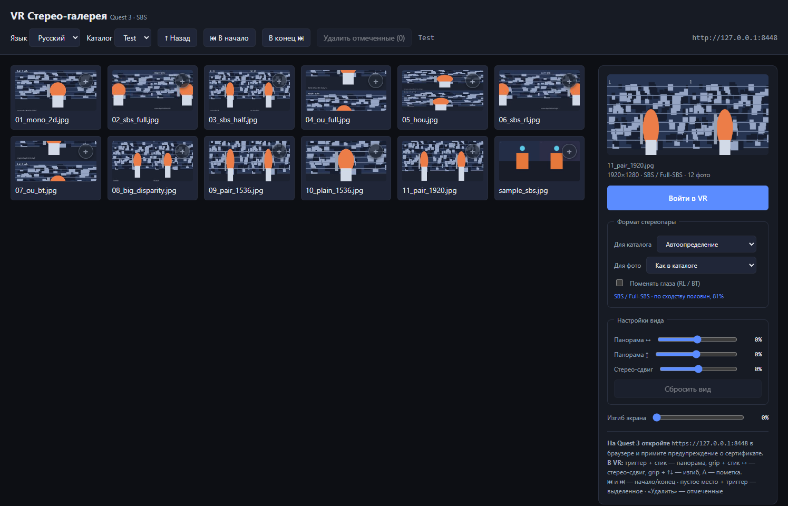

# VR-браузер SBS-стереофото для Oculus Quest 3

[English version](README.en.md)

Локальный сервер на ПК + страница в браузере очков. Никаких Steam Link / Virtual Desktop / SteamVR: Quest 3 сам рендерит стерео через **WebXR**.

## Как это работает

1. `server.py` читает `config.json` со списком каталогов и раздает:
   - веб-клиент (`web/`);
   - `/api/list` — рекурсивный обход каталогов (вложенные подкаталоги поддерживаются);
   - `/api/image` — исходное изображение (при наличии Pillow — с даунскейлом до `max_texture_size`);
   - `/api/thumb` — миниатюры (кэш в `thumbs/`).
2. В Quest Browser открывается `https://<IP-ПК>:8443`. Браузер запрашивает `immersive-vr`.
3. Файл загружается как **одна текстура**, а формат определяет, какой прямоугольник UV и какое отношение сторон использовать для каждого глаза. WebXR сам дает каждой точке зрения свою матрицу с учетом IPD — получается корректная стереопара, а не растянутый side-by-side.

## Быстрый старт

### 1. Укажите каталоги

Откройте `config.json`:

```json
{
  "ip": null,
  "port": 8443,
  "thumb_width": 320,
  "max_texture_size": 4096,
  "language": "ru",
  "statefile": "state.json",
  "qr": true,
  "qrfile": "cert/connect.png",
  "controls": {
    "panInvertX": true,
    "panInvertY": true,
    "shiftInvert": false,
    "panStep": 0.08,
    "shiftStep": 0.005,
    "panBase": 0.35,
    "panGain": 1.0
  },
  "roots": [
    {
      "id": "sbs",
      "name": "Мои SBS-фото",
      "path": "D:/Stereo",
      "sbs": "auto",
      "swap": false,
      "eye_aspect": null,
      "distance": 2.0,
      "height": 1.2
    }
  ]
}
```

- `sbs`: формат по умолчанию для каталога. `auto` — определять формат каждого файла автоматически (рекомендуется); `mono` — обычная 2D-картинка; `sbs` / `full` — каждый глаз занимает половину ширины файла без потери разрешения; `half` —half-SBS, каждый глаз сжат по горизонтали; `ou` — Full-OU / TAB / Top-and-Bottom, каждый глаз занимает половину высоты без потери разрешения; `hou` — Half-OU / HOU, каждый глаз сжат по высоте вдвое. Допустимы также псевдонимы `2d`, `full-ou`, `half-ou`, `hsbs` и т.п.
- `swap`: `true`, если в файле глаза перепутаны местами (`RL` вместо `LR`, `BT` вместо `TB`). Для конкретной картинки это можно переопределить в интерфейсе.
- `eye_aspect`: явное отношение сторон одного глаза; если `null`, считается из размера файла.
- `distance` / `height`: расстояние до плоскости и ее высота в метрах (комфортно 1.5–2.5 м).
- Можно добавить сколько угодно `roots` с разными путями и режимами.
- `language` — язык интерфейса по умолчанию (`ru`, `en` или любой другой файл из `web/i18n/`).
- `statefile` — где хранить сохраненные настройки (зум, изгиб, панорама и стерео-сдвиг по каталогам, выбранный язык и последний источник каталогов).
- `qr` — `true` (по умолчанию): при запуске сервер создает PNG со ссылкой подключения. `qrfile` — куда его сохранить. Открыть QR можно и по адресу `https://<IP-ПК>:8443/qr`. Для генерации нужен опциональный `segno` (`pip install -r requirements.txt`); без него сервер просто печатает URL. Флаг `--no-qr` отключает создание файла.
- `controls` — настройки управления панорамой и стерео-сдвигом (см. ниже).
- `delete_to_trash` — `true` (по умолчанию): удаленные картинки попадают в корзину. На **Windows** используется системная **Корзина** через встроенный Shell API (без дополнительных пакетов). На **Linux/macOS** для корзины установите `pip install send2trash`, иначе удаление будет безвозвратным. `false` — всегда удалять сразу.

#### Форматы стереопар и автоопределение

| Значение `sbs` | Что лежит в файле | Отношение сторон глаза |
|---|---|---|
| `mono` | обычная 2D-картинка, оба глаза видят одно и то же | `W/H` |
| `sbs` / `full` | две половины по ширине, каждая без сжатия | `W/H / 2` |
| `half` | две половины по ширине, каждая сжата по горизонтали | `W/H` |
| `ou` | две половины по высоте, каждая без сжатия | `W/H × 2` |
| `hou` | две половины по высоте, каждая сжата по высоте вдвое | `W/H` |

Все форматы рендерятся одной текстурой: меняются только UV-прямоугольники глаза и aspect плоскости. Отдельный шейдер для анаморфных форматов не нужен — растягивание задается геометрией.

При `sbs: "auto"` формат каждой картинки определяется по трем признакам:

1. **имя файла** — токены `sbs`, `half`, `hou`, `ou`, `tab`, `lr`, `rl`, `tb`, `bt`, `2d` и т.п. (самый сильный признак; `rl`/`bt` также включают `swap`);
2. **отношение сторон** — широкие файлы (~32:9) почти всегда full-SBS, высокие (~8:9) — Full-OU. Промежуточные значения (например 1536×1280 = 1.2) признаком OU **не** считаются;
3. **сходство половин** — картинка уменьшается до 96×64, после чего сравниваются левая/правая или верхняя/нижняя половины. Сравниваются горизонтальные границы (контуры), а не яркость, и перебирается небольшой сдвиг — это учитывает реальную диспаратность между глазами и не дает ложного сходства на повторяющихся текстурах.

Результат показывается в панели выбранного фото вместе с оценкой уверенности. Автоопределение может ошибаться на симметричных кадрах и на обычных фото, где `mono`, `half` и `hou` имеют одинаковый aspect. Поэтому в панели есть **«Формат стереопары»**: выпадающий список (включая «Автоопределение») и флаг **«Поменять глаза»**. Выбор сохраняется **для конкретного файла** в `state.json` и имеет приоритет над настройкой каталога; пункт «Как в каталоге» убирает переопределение.

### 2. Сгенерируйте сертификат

```bat
python tools\make_cert.py
```

Скрипт сам определит IP ПК и создаст `cert/cert.pem` + `cert/key.pem` с SAN `IP:<адрес>` и `DNS:localhost`.

Если IP меняется (DHCP), перегенерируйте:

```bat
python tools\make_cert.py --ip 192.168.1.50 --force
```

Либо зафиксируйте IP в `config.json` — тогда `make_cert.py` возьмет его оттуда.

### 3. Запустите

Просто:

```bat
start.bat
```

Или вручную:

```bat
python server.py
```

Доступные флаги: `--config path`, `--http` (только для `localhost`, без TLS — WebXR все равно работает, потому что `localhost` считается безопасным контекстом), `--no-qr` (не создавать QR при запуске).

При запуске сервер печатает ссылку и путь к QR-картинке:

```text
Откройте на Quest 3: https://192.168.1.50:8443
QR-код: cert/connect.png  (или https://192.168.1.50:8443/qr)
```

QR кодирует тот же адрес, что используется для сертификата. Если IP изменился, перегенерируйте сертификат и перезапустите сервер — QR обновится сам.

> Quest 3 не имеет встроенного общего QR-сканера: системный QR используется только при настройке Wi‑Fi. Чтобы открыть ссылку по QR, поставьте любое стороннее приложение-сканер в Quest (App Lab/SideQuest) либо просто введите URL вручную. После первого входа ссылку можно сохранить в закладках Quest Browser.

### Пример каталога

В комплекте идет каталог `example/` — он описан в `config.json` как источник `demo` («Тестовый пример»). Там есть примеры всех поддерживаемых форматов: `01_mono_2d.jpg`, `02_sbs_full.jpg`, `03_sbs_half.jpg`, `04_ou_full.jpg`, `05_hou.jpg`, а также `06_sbs_rl.jpg` и `07_ou_bt.jpg` с переставленными глазами/половинами. Для проверки автоопределения есть `08_big_disparity.jpg` (большая диспаратность), `09_pair_1536.jpg` (вертикальная пара 1536×1280 без подсказки в имени) и `10_plain_1536.jpg` (обычное фото того же размера в качестве контроля). Старый `sample_sbs.jpg` тоже оставлен. Выберите `demo` в списке **Каталог**, чтобы проверить работу без своих фото (для каталога включено `sbs: "auto"`):

Картинки можно пересоздать: `python tools/make_examples.py` (нужен Pillow).



### 4. На Quest 3

1. Откройте **Browser** и введите `https://<IP-ПК>:8443` (или отсканируйте созданный QR сторонним сканером).
2. При предупреждении о сертификате выберите **Advanced → Proceed** (это обязательно: без принятого сертификата WebXR не запустится).
3. Выберите фото в списке, нажмите **Войти в VR**.

   На 2D-странице прокручивается **только сетка файлов** — верхнее меню и панель выбранного изображения остаются на месте. Кнопки **«⏮ В начало» / «В конец ⏭»** в шапке переводят к первой/последней карточке текущего каталога, подсвечивают ее и открывают. В панели выбранного фото есть блок **«Настройки вида»**: **панорама ↔/↕**, **стерео-сдвиг** и кнопка **«Сбросить вид»**, а также слайдер **«Изгиб экрана»** (0% — плоский экран, как раньше; 100% — заметный изгиб). Все значения сохраняются отдельно для каждого каталога. Блок **«Формат стереопары»** показывает, как распознан текущий файл; список и флаг **«Поменять глаза»** позволяют закрепить формат или порядок глаз именно для этой картинки.

   **Пометки и удаление.** Кнопка **A** (в VR), клавиша **A/M**, кнопка **«Пометить / снять пометку»** в панели или бейдж в правом верхнем углу эскиза (в 2D; `+` — поставить, `✓` — снять) ставит/снимает пометку. В VR-просмотре помеченное фото видно по желтому **✓** в правом верхнем углу и по желтому номеру в подсказке под фото. Кнопка **«Удалить отмеченные»** в шапке (с подтверждением) удаляет помеченные фото; в VR-галерее для этого есть плашка **«Удалить (N)»** — первый триггер включает подтверждение, второй выполняет удаление (подтверждение сбрасывается через 5 секунд). Пометки действуют **только внутри текущего каталога**: при переходе в другую папку или к другому источнику они сбрасываются. Удаление по умолчанию идет в корзину (см. `delete_to_trash`).

4. Управление в VR:

   **Режим просмотра фото**
   - **Стик правого джойстика влево/вправо** — предыдущее/следующее фото (с задержкой повтора при удержании);
   - **Стик вверх/вниз** — зум (диапазон 0.6×–2.5×, текущее значение показывается в подсказке под фото). Значение **сохраняется отдельно для каждого каталога-источника** и восстанавливается при следующем входе.
   - **Триггер + стик** — панорамирование по кадру: кадр движется **в ту же сторону, куда вы двигаете стик** (вверх — вверх, вправо — вправо). Эффект есть уже при 1× и усиливается с зумом. Значения панорамы сохраняются вместе с зумом и изгибом;
   - **Grip/squeeze + стик ↔** — стерео-сдвиг правого глаза (−10%…+10% ширины половины кадра); помогает, если глаза в SBS «разъезжаются». **Grip + стик ↑↓** по-прежнему задает изгиб 0–100%. Пока grip зажат, стик не листает фото;
   - **Кнопка A** — поставить/снять пометку на текущем фото. Помеченное фото показывает желтый **✓** в правом верхнем углу и желтый номер в подсказке;
   - **Нажатие стика** или кнопка **B/Y** — открыть 3D-галерею. Триггер и grip сами по себе листание не выполняют.

   **3D-галерея**
   - 12 одновременно видимых карточек (4×3) с **вертикальной полосой прокрутки** справа: карточки плавно сдвигаются при движении курсора, полоска показывает позицию в списке;
   - **Луч правого контроллера** работает только здесь: наведение подсвечивает карточку, триггер открывает ее. В режиме просмотра фото луч выключен;
   - **Стик влево/вправо** — перемещение выделения, **вверх/вниз** — на строку вверх/вниз;
   - **Trigger** — открыть выделенное: папку — войти в нее, `↑ Назад` — на уровень выше, фото — показать его. Если нажать триггер, когда луч смотрит **в пустое место между плашками** (или ни во что), открывается элемент, выбранный **стиком** — его рамка при этом подсвечивается ярче;
   - **Кнопка A** — пометить/снять пометку с карточки под лучом (помеченные показывают **✓** в правом верхнем углу);
   - **Плашка «Удалить (N)»** — удалить помеченные (двукратное нажатие триггера: сначала подтверждение, потом удаление);
   - **Кнопки «⏮ В начало» / «В конец ⏭»** внизу галереи переводят курсор на первый/последний элемент каталога (наведите луч и нажмите триггер);
   - **Кнопка «Выйти из VR»** внизу галереи (наведите луч и нажмите триггер);
   - **Grip**, **нажатие стика** или **B/Y** — вернуться к фото.

   На ПК для проверки работают стрелки (влево/вправо — фото, вверх/вниз — зум либо строки галереи), `Shift` + стрелки (панорама), `Shift` + `[` / `]` (стерео-сдвиг), `[` / `]` (изгиб экрана), `Home` / `End` (первый/последний элемент галереи), `Enter` (открыть), `G` (переключить режим), `A` / `M` (пометка), `Delete` (удалить отмеченные) и `Escape` (выйти из VR).

   Стекло с подсказкой под фото и заголовок галереи показывают текущее управление прямо в VR.

#### Настройки управления (`controls`)

Все параметры триггер+стик вынесены в `config.json`, править код не нужно:

| Параметр | По умолчанию | Что делает |
|---|---|---|
| `panInvertX` | `true` | Стик вправо → кадр вправо. `false` — старое поведение (кадр влево). |
| `panInvertY` | `true` | Стик вверх → кадр вверх. `false` — старое поведение (кадр вниз). |
| `shiftInvert` | `false` | Инвертировать направление стерео-сдвига (grip + стик ↔). |
| `panStep` | `0.08` | Шаг панорамы за один «тик» стика (0.08 = 8% ширины половины кадра). |
| `shiftStep` | `0.005` | Шаг стерео-сдвига (0.5% ширины глаза). |
| `panBase` | `0.35` | Коэффициент панорамы при 1× (чтобы слайдер работал без зума). |
| `panGain` | `1.0` | Дополнительный коэффициент, включаемый с увеличением зума. |

Инверсия применяется и к клавиатурным `Shift` + стрелки, и к VR-стику — направление движения везде одинаковое. Диапазоны значений ограничены на сервере; некорректные значения заменяются на умолчания.

### 5. Язык интерфейса

Язык можно выбрать в выпадающем списке **«Язык»** на 2D-странице — он применится сразу и к 2D-интерфейсу, и к подсказкам внутри VR. Выбор сохраняется.

Задать язык по умолчанию можно в `config.json` (`"language": "ru"`). Если в сохраненном состоянии уже выбран язык, он имеет приоритет над конфигом.

Тексты лежат в **отдельных JSON-файлах** `web/i18n/<код>.json` — это оптимальный вариант для нашего случая: сервер сам находит все файлы и отдает список языков через `/api/i18n/list`, поэтому новый язык добавляется **одним файлом, без правки кода**.

Формат файла — плоский словарь ключ → строка. Ключ `__name` — название языка в списке, остальные ключи соответствуют `data-i18n` в `web/index.html` и строкам, рисуемым в VR. В строках можно использовать подстановки `{name}`, `{zoom}`, `{index}` и т.п.:

```json
{
  "__name": "Deutsch",
  "title": "VR Stereo-Galerie · Quest 3",
  "vrLabelHint": "Stick ← → blättern · ↑ ↓ Zoom {zoom}× · Stick/B — Galerie"
}
```

Достаточно перевести ключи из `web/i18n/en.json` — файл появится в списке языков после перезапуска страницы (сервер перезапускать не нужно).

**Правило для русского языка.** Во всех русскоязычных текстах проекта — документации, `web/i18n/ru.json`, строках интерфейса и комментариях — буква `ё` пишется как `е`: `все`, `желтый`, `раздает`, `сохраненное`. Такой единый стиль упрощает поиск и избегает проблем с кодировками на разных устройствах.

Сохраненные настройки (зум, изгиб и блок `view` с панорамой/стерео-сдвигом по каталогам, ручные форматы конкретных картинок, язык и последний выбранный источник каталогов) лежат в `state.json` — этот файл в `.gitignore` и не попадает в коммит. При следующем запуске страницы выбранный источник восстанавливается; если он больше не описан в `config.json`, используется первый.

## Roadmap

Пока не реализовано.

### Ближайший горизонт

- [ ] **Хэнд-трекинг.** Управление без контроллеров через WebXR `hand-tracking`: жест «щипок» вместо триггера, движение кисти для панорамы, разведение пальцев для зума. Сейчас все действия привязаны к стику и кнопкам — нужны жесты-аналоги для листания фото, открытия карточки, пометки и удаления, а также подсказки, которые переключаются в зависимости от активного способа ввода.
- [ ] **MR (mixed reality).** Сессия `immersive-ar` с цветным passthrough Quest 3: разместить фото-панель и 3D-галерею в реальной комнате, менять положение и размер панели руками. Потребуется отдельный режим WebXR-сессии, «привязка» к пространству и адаптация интерфейса (текущий бар рассчитан на VR).

### Средний горизонт

- [ ] **Несколько гарнитур.** Две и более Quest одновременно подключены к одному серверу. Базовый вариант — **свободный просмотр**: у каждой сессии свое выбранное фото, зум/изгиб/панорама и пометки. Сейчас состояние хранится общее на каталог, поэтому сессии перетирают друг друга — нужен канал синхронизации (WebSocket/SSE) и состояние в разрезе сессий.

  Поверх этого — **режим ведущей гарнитуры** («смотрим вместе»):

  - ведущий листает фото, выбирает папку и меняет настройки вида (зум, изгиб, панорама, стерео-сдвиг) — все это транслируется остальным;
  - у ведомых управление кадром на это время заблокировано, чтобы не возникало рассинхрона;
  - ведущий назначается первым подключившимся или выбирается вручную; передача роли — отдельная кнопка/жест; при отключении ведущего роль переходит к следующему;
  - пометки и удаление по умолчанию остаются **локальными** для каждой гарнитуры, чтобы один человек не мог удалить фото у всех; общие пометки — опция.
- [ ] **Пульт на телефоне.** Компаньон-страница в той же сети: список фото, выбор, листание, панорама и управление слайдшоу с телефона. Подключение по QR со ссылкой на сессию гарнитуры, единый канал команд с VR-клиентом.
- [ ] **Слайдшоу.** Автопереход по фото с настраиваемым интервалом, плавное проявление между кадрами, пауза/продолжение и перемешивание. Управление из VR и с телефона-пульта; интервал и порядок сохраняются вместе с остальными настройками каталога.

## Зависимости

Сервер работает на чистом Python 3.10+: внешние пакеты не нужны.

`Pillow` необязателен (`pip install -r requirements.txt`): без него миниатюры и даунскейл отключены, и браузер будет скачивать полные файлы — на большой коллекции это заметно медленнее. Он также нужен только для пересоздания тестовых картинок (`tools/make_examples.py`); само автоопределение работает в браузере через `<canvas>` и без Pillow.

`segno` тоже необязателен: он нужен только для генерации QR-картинки при запуске. Без него сервер работает как раньше и печатает ссылку в консоли.

## Структура

```
config.json        — каталоги и параметры отображения
server.py          — HTTP(S)-сервер и JSON API
tools/make_cert.py — самоподписанный сертификат с SAN IP
tools/make_examples.py — генератор тестовых картинок всех форматов в example/
web/index.html     — 2D-браузер файлов и кнопка входа в VR
web/app.js         — загрузка и автоопределение формата, WebGL-рендер, WebXR-сессия, ввод
web/style.css
web/i18n/*.json    — файлы локализаций (один файл = один язык)
state.json         — сохраненные zoom/curve/view по каталогам, ручные форматы картин, язык и источник (не коммитить)
cert/              — сертификаты и connect.png с QR (не коммитить)
thumbs/            — кэш миниатюр (не коммитить)
LICENSE            — лицензия MIT
docs/              — скриншоты для документации
```

## Частые проблемы

- **Кнопка «Войти в VR» пишет, что WebXR недоступен** — страница открыта по `http://<IP>`, а не по HTTPS. Нужен `https://` и принятый сертификат.
- **Файлы не видны** — проверьте `path` в `config.json` (на Windows используйте прямой слеш `D:/Stereo`) и расширения: поддерживаются `.jpg .jpeg .png .webp`.
- **Картинка выглядит «вытянутой»** — неверно определен формат. Выберите нужный в блоке **«Формат стереопары»** панели выбранного фото (`sbs` ↔ `half` ↔ `ou` ↔ `hou`) либо задайте `sbs` в каталоге и/или `eye_aspect` числом.
- **Глаза поменялись местами или картинка «вывернута»** — включите **«Поменять глаза»** для этого файла или `swap: true` для всего каталога.
- **Автоопределение ошибается** — это ожидаемо для симметричных кадров и обычных фото формата 16:9: закрепите формат вручную через **«Формат стереопары»**, он сохранится в `state.json`.
- **Текстура не загружается на Quest 3** — уменьшите `max_texture_size` до 2048.
- **Тормозит сеть** — подключите ПК кабелем, очки используйте в 5 ГГц; включите Pillow для миниатюр.

## Безопасность

Сервер отдает файлы **только из каталогов, перечисленных в `roots`**. Пути с `..` и символические ссылки за пределы каталога отклоняются. Слушать `0.0.0.0` нужно только в доверенной домашней сети.

## Лицензия

[MIT](LICENSE) — можно свободно использовать, изменять и распространять, в том числе в коммерческих проектах. Единственное условие — сохранять уведомление об авторстве и текст лицензии.
